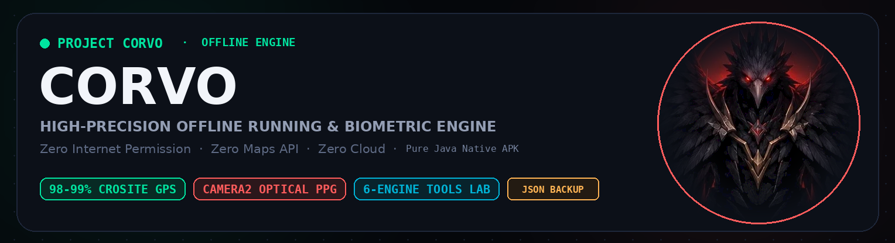
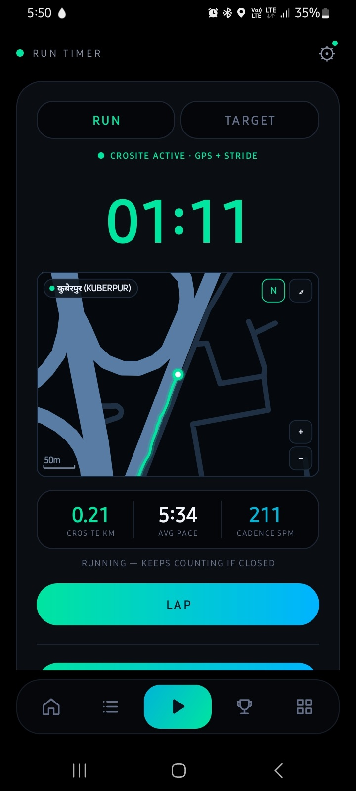
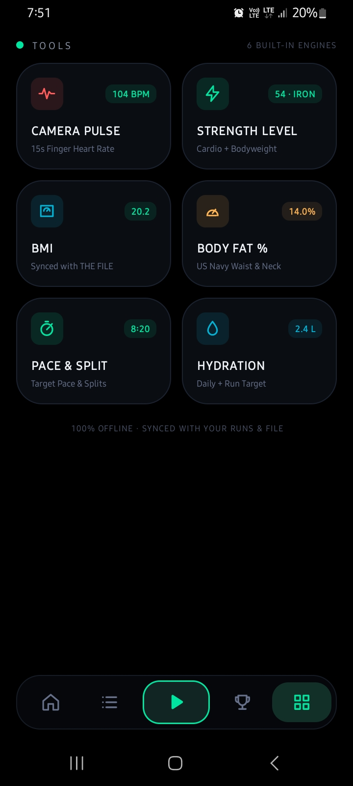
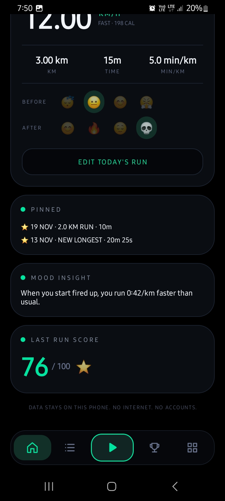
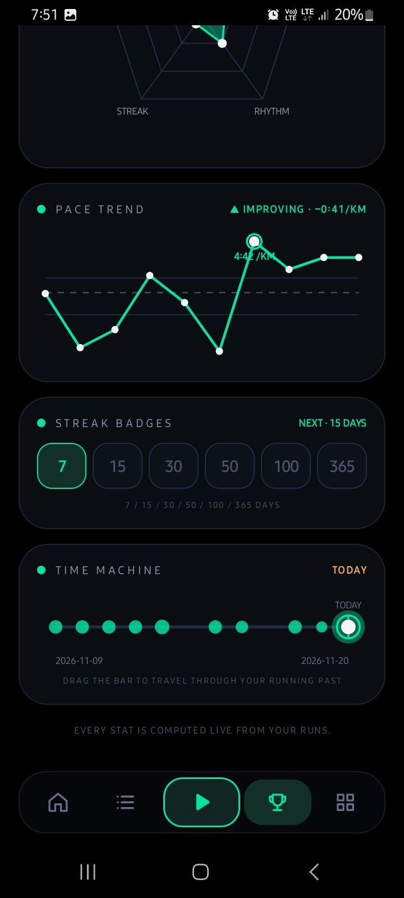
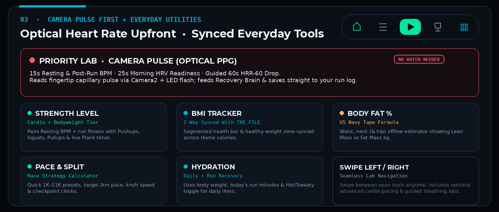
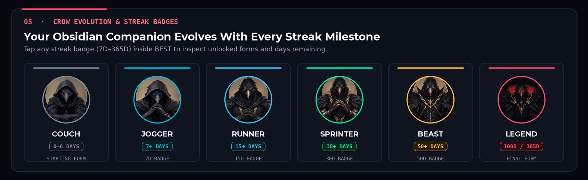

<div align="center">



<p>
  
  
  
  
  
</p>

<h3>
  <a href="https://github.com/Ayushxxy/Corvo/releases/latest">Download Latest APK</a>
  &nbsp;&middot;&nbsp;
  <a href="#screenshots">Screenshots</a>
  &nbsp;&middot;&nbsp;
  <a href="#05--crow-evolution--streak-badges">Crow Ranks</a>
  &nbsp;&middot;&nbsp;
  <a href="#built-in-safeguards--hidden-powers">Safeguards &amp; Hidden Powers</a>
  &nbsp;&middot;&nbsp;
  <a href="#build-from-source-no-gradle">Build From Source</a>
</h3>

</div>

---

## Why Corvo Exists

Most fitness apps are **150–300 MB**, force logins and cloud sync, charge subscriptions for basic stats, and quietly collect your GPS routes and health patterns.

**Corvo is built on a different rule:**
- **Ultra-lightweight native APK (`< 450 KB`)** — smaller than a single photo, zero lag even on budget phones.
- **Zero `INTERNET` permission** — physically incapable of uploading, tracking, or calling any server.
- **Real sensor engineering inside one AMOLED app** — 3-layer offline GPS/Stride tracker, real-time Camera + Flash optical heart rate scanner, recovery intelligence, and 6 synced physiology labs.

---

## Screenshots

### Core Experience — Home, CroSite Timer, Camera Pulse & Tools
| Home & Recovery | CroSite Timer & Rest | Camera Pulse PPG | Tools (6 Engines) |
| :---: | :---: | :---: | :---: |
|  |  |  |  |

### Deep Insights — Mood, Run Log, Radar & Time Machine
| Mood Insight & Score | History & Backup | Radar & Week-over-Week | Trends & Time Machine |
| :---: | :---: | :---: | :---: |
|  |  |  |  |

---

## 01 &middot; CroSite — 3-Layer Offline GPS + Stride Bridge
*Inside the center **`▶`** tab (`CROSITE GPS` vs `TIMER ONLY`).*

Raw GPS bounces around while standing still and drops out under trees or flyovers. **CroSite** combines three lightweight layers so distance stays honest without Maps APIs or internet:

1. **Motion Guard (Zero Ghost Drift):** Reads the phone accelerometer to confirm real footsteps before accepting small GPS jumps — standing at a crossing won't add fake meters.
2. **Smart Satellite Gate & Screen-Off Tracking:** Filters weak indoor fixes while still capturing sprints, running cleanly in your pocket via a low-power foreground service (`PARTIAL_WAKE_LOCK`).
3. **Self-Calibrating Stride Bridge:** Learns your personal stride length from height + clean GPS segments. If signal temporarily drops under trees or bridges, it bridges the gap cleanly without double-counting when GPS returns.
4. **60s `LAP` Rest Auto-Pause:** In `RUN` mode, tapping `LAP` records your split and starts a 1-minute walk break — **CroSite automatically pauses during rest** and resumes the second you finish or tap `SKIP REST`.


---

## 02 &middot; Camera Pulse — Live Optical Heart Rate (PPG)
*Inside `TOOLS → CAMERA PULSE` (and offered in 1 tap right after saving a timed run).*

Check your **Resting** or **Post-Run BPM** anytime without a smartwatch, using only your rear camera and LED flash:

- **How it works:** Every heartbeat pushes blood into your fingertip, changing how light passes through your skin. Gently covering both the rear lens and flash lets Corvo read subtle brightness shifts **30 times per second** and plot a real-time pulse waveform.
- **No auto-exposure glitches:** Phone cameras normally auto-adjust brightness continuously, ruining pulse waves. Corvo waits `1.5s` for your finger to settle, then **locks exposure & white balance** so only your heartbeat remains.
- **Built for real hands:** A 2-pass zero-phase filter cancels tiny hand tremors and breathing sway, then checks both beat-to-beat intervals and signal rhythm across `42–205 BPM`. If the signal is shaky or pressed too hard, Corvo **rejects it cleanly instead of guessing**.
- **Connected Ecosystem:** Measurements tag as **`RESTING`**, **`POST-RUN`**, or **`CHECK`** inside **Pulse Log**. Post-run BPM attaches directly to your run record, and your Resting BPM feeds automatically into **Strength Level**.


---

## 03 &middot; TOOLS — 6 Synced Offline Performance Labs
All 6 tools share a single source of truth with your **`THE FILE`** profile — enter height or weight once and everything updates together:

- **Camera Pulse:** 15s finger PPG scanner + tagged Pulse Log + Resting BPM baseline.
- **Strength Level:** Fuses automatic Cardio + Resting BPM with bodyweight reps (**Pushups, Squats, Pullups** + built-in live **Plank** stopwatch).
- **BMI Tracker:** Segmented health zone synced two-way with `THE FILE`.
- **Body Fat %:** Offline US Navy waist/neck/hip estimator showing Lean Mass vs Fat Mass.
- **Pace & Split Calculator:** Instant target paces, speeds, and checkpoint splits (`1K–21K`).
- **Hydration Target:** Daily baseline + run recovery liters tuned to temperature and duration.



---

## 04 &middot; Recovery Brain, Time Machine & Zero-Surveillance Core

- **Recovery Brain (`PRIMED · STEADY · CAUTION · REST CALL`):** Compares this week against your personal baseline across **Load, Intensity, Fatigue & Mood**. Up to **2 flexible Rest Days/week** protect your streak, and **`REST TODAY`** lets you shift a rest day immediately when overloaded.
- **Time Machine & 5-Axis Radar (`BEST` tab):** Scrub the timeline slider backward to inspect streaks, tiles, and trends on any past date.
- **Mood Insight & `THE FILE`:** Log before/after mood emojis to learn in plain English how mood changes your `/km` pace; tap the Home Crow card anytime to open **`THE FILE`** (dossier, age, BMI, Strongest Day & Dossier PNG).
- **Offline PNG Cards & Single-File JSON Backup (`LOG` tab):** Share dark AMOLED **Radar, Stat, Day (with lap curves)**, and **Dossier** posters offline, or export/merge everything into one portable `corvo-backup.json` file.


---

## 05 &middot; Crow Evolution & Streak Badges
Every run keeps your streak alive (backed by up to **2 flexible Rest Days/week**). As your consistency grows across **`7D · 15D · 30D · 50D · 100D · 365D`** milestones, your obsidian companion transforms on both the **Home screen** and **`THE FILE` Dossier**:



| Streak Range | Crow Rank | Badge Milestone | What Happens |
| :---: | :--- | :---: | :--- |
| **0–6 Days** | **COUCH** | Starting Form | Cloaked obsidian recruit; working toward the 7-day mark |
| **7–14 Days** | **JOGGER** | `7D` Badge | First week locked in; bronze cuffs unlocked |
| **15–29 Days** | **RUNNER** | `15D` Badge | Hood drops; gold trim appears as cadence settles |
| **30–49 Days** | **SPRINTER** | `30D` Badge | One full month of discipline; armored collar |
| **50–99 Days** | **BEAST** | `50D` Badge | Winged obsidian mantle forged at 50 consecutive days |
| **100D / 365D** | **LEGEND** | `100D` · `365D` | Final crimson medallion form & full 1-year crown |

> **Tip:** Tap any badge pill (`7`, `15`, `30`, `50`, `100`, `365`) inside the **`BEST`** tab to preview its Crow evolution and check exact days left!

---

## Built-In Safeguards & Hidden Powers

<details>
<summary><b>🛡️ 8 Automatic Safeguards (Typo Guard, Spike Warnings & Signal Protection)</b></summary>

1. **Smart Typo Guard (`DOUBLE-CHECK`):** Accidentally entered `30` km instead of `3.0` km, or unrealistically fast timing? Whenever distance exceeds **`3×` your longest run ever** or pace is faster than **`2:30/km`**, Corvo pauses before saving and asks you to verify (`Save anyway?`). Impossible inputs (`>200 km` or `>600 min`) are blocked outright.
2. **Weekly Ramp Guard (`TAPER DOWN` / `SWEET SPOT`):** Automatically compares this week's total distance against last week's (`0.8×–1.5×` = sweet spot; **`≥ 1.5×` jump** displays an amber **`LOAD X.X× LAST WEEK · TAPER DOWN`** alert).
3. **Single-Day Spike Detector:** If yesterday's run was **`≥ 2.5×` your previous week's daily average** (minimum 3 km), Recovery Brain triggers **`REST CALL`** (*"Yesterday was big"*) and offers **`REST TODAY`** to protect your streak.
4. **Cold-Start Protection (`STILL LEARNING`):** New runners are never falsely warned about overload on Day 1 — Corvo waits until you build a real multi-run baseline first.
5. **Camera Pulse Anti-Fake-BPM Lock:** If you press too hard (blocking fingertip blood flow) or move mid-scan, Corvo refuses to show a random guess.
6. **Process-Death Timer & Rest Survival:** If the phone kills background apps or reboots mid-run, reopening Corvo restores your exact elapsed stopwatch, recorded laps, and 60s rest countdown.
7. **Weekly Silent Auto-Backup (`corvo-auto.json`):** Once you have 3+ runs, Corvo quietly maintains a single rolling snapshot in `Documents/Corvo/corvo-auto.json` every 7 days without cluttering storage.
8. **Non-Destructive Backup Import:** Importing `corvo-backup.json` merges runs, laps, BPM, and Pulse Log cleanly — never wiping existing entries.

</details>

<details>
<summary><b>⚡ Hidden Triggers, Gestures & Quick Settings Tile (Also inside Settings → HOW TO USE)</b></summary>

| Where | Action | What It Opens / Triggers |
| :--- | :--- | :--- |
| **Top `CORVO` Logo** | Tap | Opens **Corvo's Identity Card** (Rank, Class, Bonded Runner & Skills) |
| **Home Crow Card** | Tap | Opens **`THE FILE`** (Full runner dossier + 1-dialog editor + Share Dossier) |
| **Recovery Strip** | Tap | Opens 4-bar breakdown (**Load · Intensity · Fatigue · Mood**) + **`REST TODAY`** |
| **Big Run Score Number** | **Long-Press** | Shows exact formula breakdown (Dist 30% · Pace 40% · Rhythm 20% · Impr 10%) |
| **Any Run in `LOG`** | **Swipe Right** | Pins / unpins a **⭐ Milestone** directly onto your Home screen |
| **Tool Slider Readouts** | Tap big number | Lets you type an exact custom number instead of dragging |
| **Phone Quick Settings** | Add **`Corvo`** Tile | Pull down shade & tap once from anywhere to jump straight into a live run timer |
| **Launcher Widgets** | Add **`1×1` Corvo** | Live home-screen streak counter (zero background drain) |
| **Settings (Gear Icon)** | Tap **`HOW TO USE`** | Built-in offline cheat sheet covering every screen and trigger |

</details>

<details>
<summary><b>🔒 Zero-Surveillance Permissions & Build From Source (No Gradle)</b></summary>

### Permissions
`INTERNET` is **completely absent** from `AndroidManifest.xml`:
- `ACCESS_FINE_LOCATION` / `FOREGROUND_SERVICE` / `WAKE_LOCK` — Optional; used only when running with **CroSite GPS** active.
- `CAMERA` — Optional; used only when opening **Camera Pulse** to read optical fingertip BPM (zero images/videos stored).
- `POST_NOTIFICATIONS` — Optional; used only to display the silent live distance notification during an active CroSite run.

### Build From Source (CLI · ~5 Seconds)
Corvo compiles directly using Android SDK 33 build-tools (`aapt2`, `javac`, `d8`, `zipalign`, `apksigner`) with zero Gradle overhead:

```bash
# 1. Install Android SDK 33 + JDK 17 into /var/tmp/carvo-sdk
bash setup.sh

# 2. Compile, dex, align, and sign with a local debug keystore
bash build.sh
```

Output APK is saved to `app/build/Corvo-debug.apk`.

</details>

---

## Download & Install

1. Open the **[Releases](https://github.com/Ayushxxy/Corvo/releases/latest)** page.
2. Download the latest **`Corvo-*.apk`**.
3. Install on **Android 7.0+** (`minSdk 24`, `targetSdk 33`).
4. On first launch, enter your name and optional height/weight/DOB/city — calories, BMI, and CroSite Stride Bridge calibrate immediately.

---

## License

Released under the **[GNU General Public License v3.0 (GPLv3)](LICENSE)**. You are free to inspect, fork, and modify Corvo, provided derivative works remain open-source under GPLv3.
