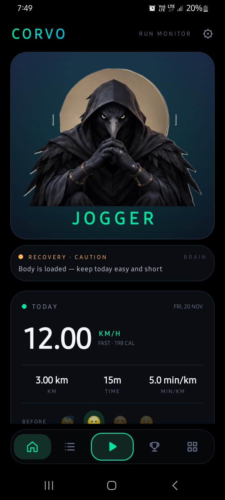
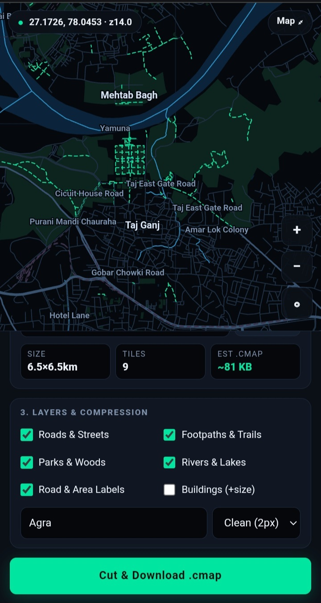
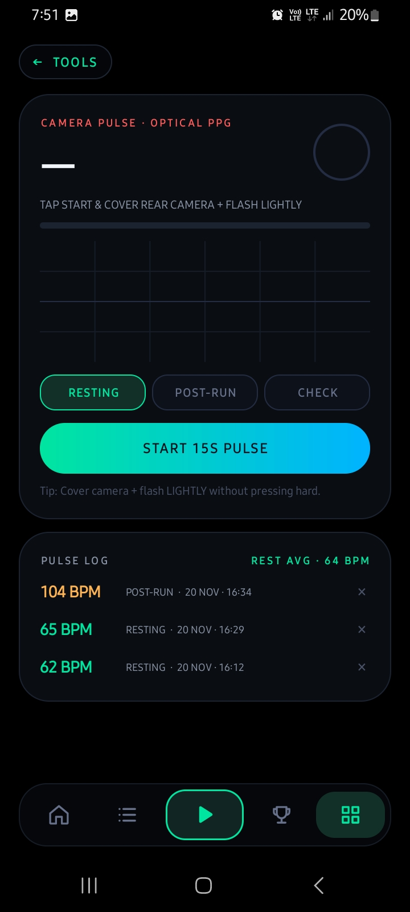
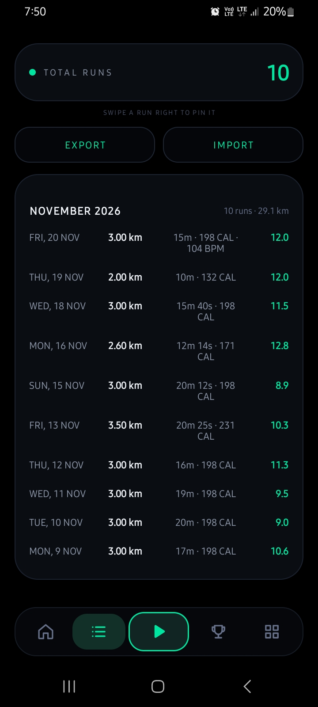
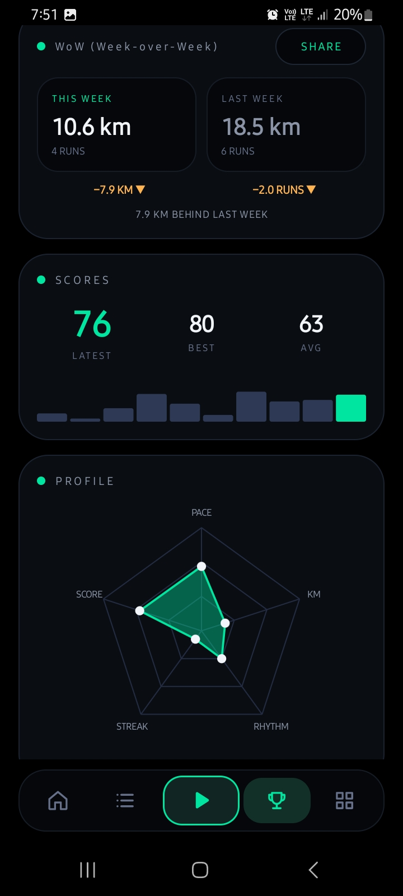
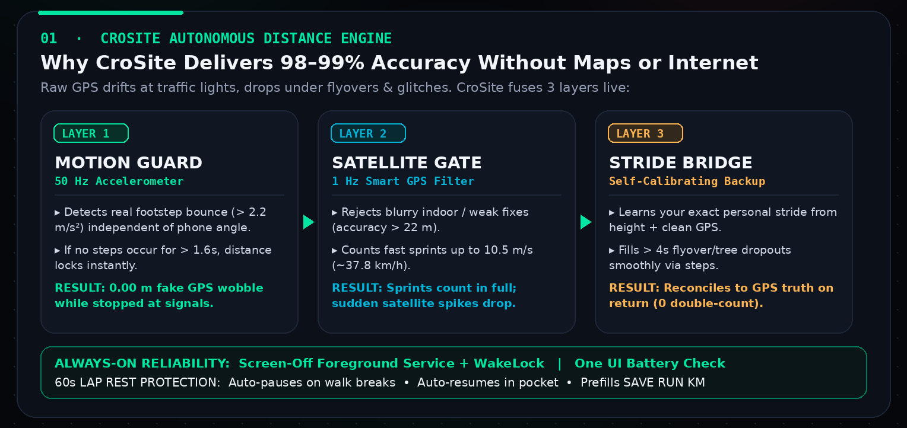
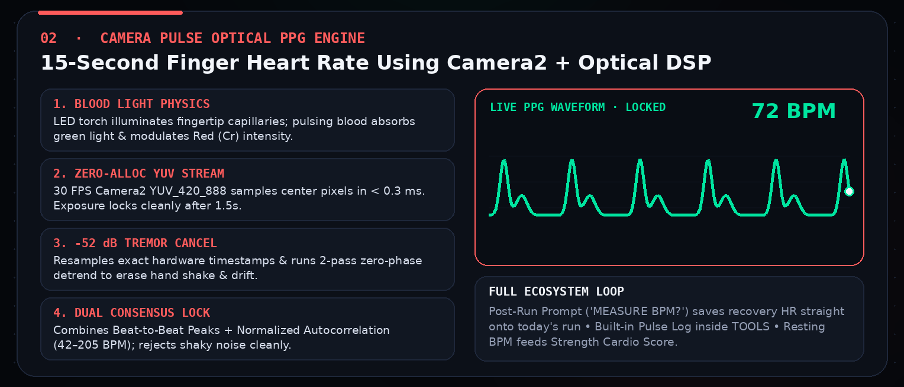
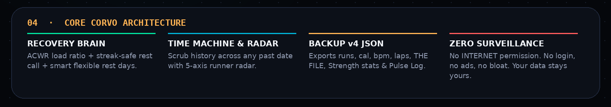

<div align="center">


<p>
  
  
  
  
  
  
</p>

<h3>
  <a href="https://github.com/Ayushxxy/Corvo/releases/latest">Download v5 APK</a>
  &nbsp;&middot;&nbsp;
  <a href="#screenshots">Screenshots</a>
  &nbsp;&middot;&nbsp;
  <a href="#01--crosite-gps--offline-vector-maps-cmap">Offline Maps &amp; CroSite</a>
  &nbsp;&middot;&nbsp;
  <a href="#02--camera-pulse--optical-heart-rate-ppg">Camera Pulse PPG</a>
  &nbsp;&middot;&nbsp;
  <a href="#05--crow-evolution--streak-badges">Crow Ranks</a>
  &nbsp;&middot;&nbsp;
  <a href="#build-from-source-no-gradle">Build From Source</a>
</h3>

</div>

---

## Why Corvo Exists

Most running apps weigh **150–300 MB**, lock your stats behind logins and subscriptions, drain battery with background telemetry, and silently upload your GPS routes.

**Corvo v5 flips the rules:**
- **Tiny Native APK (`444 KB`)** — smaller than one photo, opens instantly even on budget Android phones.
- **Zero `INTERNET` Permission** — physically unable to upload routes, heart rate readings, or body metrics to any server.
- **Offline Maps + Real Sensor Engineering** — 3-layer GPS + Stride tracking, custom **`~80 KB` offline vector area maps** (`.cmap`), **0.85x Voice Coach**, **Camera2 optical heart rate (PPG)**, and recovery intelligence in one pure AMOLED interface.

---

## Screenshots

### Core Experience — Home, Live CroSite Map, Offline Map Cutter & Camera Pulse
| Home & Crow Companion | CroSite + Offline Vector Map | Corvo Map Cutter (`.cmap`) | Camera Pulse (PPG) |
| :---: | :---: | :---: | :---: |
|  |  |  |  |

### Deep Insights — Mood, Run Log, 5-Axis Radar & Time Machine
| Mood Insight & Score | History & Backup | Radar & Week-over-Week | Trends & Time Machine |
| :---: | :---: | :---: | :---: |
|  |  |  |  |

---

## 01 &middot; CroSite GPS + Offline Vector Maps (`.cmap`)
*Inside the center **`▶`** tab (`RUN` or `TARGET` mode with `CROSITE GPS` / `TIMER ONLY`).*

Corvo tracks outdoor runs accurately **without Google Maps SDKs, accounts, or internet access** — and even renders your streets, parks, waterways, live GPS route trail, and turnaround point completely offline:

### Offline Area Maps (`.cmap` + Included `corvo-map-cutter.html`)
- **Zero APK Bloat, Zero Internet:** Corvo stays `444 KB` by reading ultra-compact binary **`.cmap`** vector packs (`~40–150 KB` per neighborhood/city) that you cut yourself using the included **`corvo-map-cutter.html`** (runs on phone or PC browser).
- **Three Cut Modes:** Cut a **Square** radius (`2.5–24 km`), drag a freeform **Photo Crop** box, or tap out a custom **Polygon** loop along your exact route.
- **Smooth Offline Controls:** **2-finger rotate** (street names stay upright), **pinch zoom**, **`⤢`** map expand toggle, **`◎` / `N`** instant snap back to GPS & North, live glowing route trail, and automatic turnaround marker.

### 3-Layer CroSite Engine + Smart Run Coaching
1. **Motion Guard (Zero Signal Drift):** Uses the 50 Hz accelerometer to require real footstep motion before counting small GPS shifts — standing at traffic lights adds `0.00 m` drift.
2. **Smart Satellite Gate & Pocket Service:** Rejects blurry indoor fixes while capturing fast sprints up to `10.5 m/s`, running reliably with the screen locked via a foreground service.
3. **Self-Calibrating Stride Bridge:** Learns your stride from height + clean GPS stretches to bridge signal drops under trees or flyovers without double-counting.
4. **Target Mode, Voice Coach & Cadence:** Pick **Target Time** or **Target Distance** (`auto-saves` in your pocket on finish with a calm slow-down voice countdown), toggle **`0.85x` offline Voice Coach**, customize **Pre-Run Warm-Up** drills, turn on the **Cadence Metronome**, track **live SPM + OUT/BACK turnaround splits**, and auto-pause CroSite during **`60s` Lap Rest** breaks.



---

## 02 &middot; Camera Pulse — Optical Heart Rate (PPG)
*Priority lab inside `TOOLS → CAMERA PULSE` (plus 1-tap prompt right after finishing a timed run).*

Check your heart rate anytime without a smartwatch or chest strap — using only your phone's rear camera and LED flash:

- **15s Resting & Post-Run BPM:** Gently cover the rear camera lens and flash with one fingertip. Corvo captures **30 FPS brightness shifts**, plots a live pulse waveform, and calculates BPM across `42–205 BPM`.
- **No Auto-Exposure Glitches:** Waits `1.5s` for your fingertip to settle, then **locks exposure & white balance** so camera brightness adjustments never corrupt the heartbeat wave.
- **Tremor Filter + Honest Reject:** A 2-pass zero-phase filter removes tiny hand shake; dual peak + autocorrelation checks reject pressed/shaky reads instead of guessing a fake number.
- **Morning HRV & 60s HRR-60 Recovery:** Run a **25s Morning HRV (`RMSSD ms`)** check (feeds straight into Recovery Brain) or a guided **60s HRR-60** post-run drop test. Measurements tag cleanly as **`RESTING`**, **`POST-RUN`**, or **`CHECK`** inside Pulse Log and attach to today's run.



---

## 03 &middot; Everyday Synced Tools (Camera Pulse First)
Built around **Camera Pulse (PPG)** at the top, every tool shares a single profile with **`THE FILE`** — enter height or weight once and everything updates automatically:

- **Camera Pulse (PPG) — Priority Tool:** Resting/Post-Run BPM, Morning HRV readiness, 60s HRR-60 drop & tagged Pulse Log.
- **Strength Level:** Pairs cardio fitness + Resting BPM with bodyweight reps (**Pushups, Squats, Pullups** + built-in **Plank** stopwatch).
- **BMI Tracker:** Segmented health zone synced two-way with `THE FILE`.
- **Body Fat %:** Offline US Navy waist/neck/hip estimator showing Lean Mass vs Fat Mass.
- **Pace & Split Calculator:** Instant target paces, speeds, and checkpoint splits (`1K–21K`).
- **Hydration Target:** Daily baseline + run recovery liters adjusted for run time and hot/sweaty weather.

<details>
<summary><b>➕ More Built-In Labs (Swipe Left/Right Inside Tools)</b></summary>

Inside any open tool, swipe left or right (or tap `‹ / ›`) to browse smoothly through two additional specialized labs tucked neatly at the bottom of the grid:
- **Cardio Fitness Zones & Race Predictor:** Estimates training pace zones (`Z1–Z5`), fitness age, and `1K / 5K / 10K / Half-Marathon` finish estimates from your best runs.
- **Breath Tolerance & Post-Run Cooldown Pacer:** Simple morning breath-hold tracker plus a guided `4s Inhale · 6s Exhale` cooldown pacer.

</details>


---

## 04 &middot; Recovery Brain, Time Machine & Offline Core

- **Recovery Brain (`PRIMED · STEADY · CAUTION · REST CALL · DONE FOR TODAY`):** Reads weekly **Load, Intensity, Fatigue & Mood**, shifts to a calm **`DONE FOR TODAY`** recharge state after you log a run, and protects streaks with up to **2 flexible Rest Days/week** + 1-tap **`REST TODAY`**.
- **Time Machine & Dual 5-Axis Radar (`BEST` tab):** Switch between **All-Time** and **14D Form** radar shapes, and drag the Time Machine slider to rewind your stats to any past day.
- **Mood Insight & `THE FILE`:** Track before/after mood emojis to see in plain English how mood shifts your `/km` pace; tap the Home Crow card anytime to inspect/edit **`THE FILE`** or export a Dossier card.
- **Dark AMOLED Share Cards & Single-File JSON Backup (`LOG` tab):** Export dark **Radar, Period Stat, Day (splits/cadence/BPM)**, and **Dossier** posters offline, or back up and merge everything (`runs, laps, BPM, HRV, cadence, splits, profile, Pulse Log & Warm-Up`) via one `corvo-backup.json` file.



---

## 05 &middot; Crow Evolution & Streak Badges
Every run keeps your streak moving (backed by up to **2 flexible Rest Days/week**). Across **`7D · 15D · 30D · 50D · 100D · 365D`** milestones, your obsidian companion evolves on **Home** and inside **`THE FILE`**:


| Streak Range | Crow Rank | Badge Milestone | What Happens |
| :---: | :--- | :---: | :--- |
| **0–6 Days** | **COUCH** | Starting Form | Cloaked obsidian recruit; working toward the 7-day mark |
| **7–14 Days** | **JOGGER** | `7D` Badge | First week locked in; bronze cuffs unlocked |
| **15–29 Days** | **RUNNER** | `15D` Badge | Hood drops; gold trim appears as cadence settles |
| **30–49 Days** | **SPRINTER** | `30D` Badge | One full month of discipline; armored collar |
| **50–99 Days** | **BEAST** | `50D` Badge | Winged obsidian mantle forged at 50 consecutive days |
| **100D / 365D** | **LEGEND** | `100D` · `365D` | Final crimson medallion form & full 1-year crown |

> **Tip:** Tap any badge pill (`7`, `15`, `30`, `50`, `100`, `365`) inside **`BEST`** to preview its Crow evolution and days left.

---

## Guides, Safeguards & Build

<details>
<summary><b>🗺️ How to Make Offline .cmap Maps in 60 Seconds (Corvo Map Cutter)</b></summary>

1. Open **`corvo-map-cutter.html`** from this repo in any phone or desktop browser (works on mobile portrait too — tap **`Map ⤢`** or **`Panel ⤢`** anytime).
2. Search your city/park or paste `lat, lon`, then choose **Square**, **Photo Crop** (drag corners/edges), or **Polygon** (tap out your custom route loop).
3. Pick layers (Roads, Footpaths, Parks, Rivers, Labels) and tap **`Cut & Download .cmap`** (`~40–150 KB`, fetched once from OpenFreeMap in your browser).
4. Inside Corvo, open **`PLAY (▶)` → top-right `⚙` → `OFFLINE AREA MAP` → `IMPORT .CMAP`**. Corvo stores it privately offline forever — zero internet inside the app!

</details>

<details>
<summary><b>🛡️ 8 Automatic Safeguards (Typo Guard, Ramp Alerts & Timer Survival)</b></summary>

1. **Smart Typo Guard (`DOUBLE-CHECK`):** Flags unlikely entries (`> 3×` longest run or faster than `2:30/km`) before saving and blocks impossible totals (`> 200 km` or `> 600 min`).
2. **Weekly Ramp Guard:** Flags rapid mileage jumps (`≥ 1.5×` last week → `TAPER DOWN`) and highlights `0.8×–1.5×` (`SWEET SPOT`).
3. **Single-Day Spike Detector:** Recommends **`REST CALL` / `REST TODAY`** if yesterday exceeded `2.5×` your prior daily average.
4. **Cold-Start Protection (`LEARNING`):** New runners aren't warned about fatigue before building a real baseline.
5. **Anti-Fake-BPM Lock:** Rejects washed-out or shaky fingertip scans rather than displaying random numbers.
6. **Process-Death Timer Survival:** Recovers exact elapsed time, laps, CroSite state, and 60s rest countdown after phone kills/reboots.
7. **Weekly Silent Auto-Backup (`corvo-auto.json`):** Maintains one rolling snapshot in `Documents/Corvo/` once you pass 3 runs.
8. **Non-Destructive Merge Import:** Importing `corvo-backup.json` merges runs, laps, BPM, cadence, and Pulse Log cleanly without overwriting history.

</details>

<details>
<summary><b>⚡ Hidden Triggers, Gestures & Quick Settings Tile (Also inside Settings → HOW TO USE)</b></summary>

| Where | Action | What It Opens / Triggers |
| :--- | :--- | :--- |
| **Top `CORVO` Logo** | Tap | Opens **Corvo's Identity Card** (Rank, Class & Skills) |
| **Home Crow Card** | Tap | Opens **`THE FILE`** (Full runner dossier + inline edit + Share Dossier) |
| **Recovery Strip** | Tap | Opens 4-bar breakdown (**Load · Intensity · Fatigue · Mood**) + **`REST TODAY`** |
| **Big Run Score Number** | **Long-Press** | Shows exact formula weights (Dist 30% · Pace 40% · Rhythm 20% · Impr 10%) |
| **Any Run in `LOG`** | **Swipe Right** | Pins / unpins a **⭐ Milestone** onto your Home screen |
| **`PLAY` Gear (`⚙`)** | Tap | Configures **Voice Coach**, **Warm-Up Editor**, **Metronome SPM** & **`.cmap` Offline Map** |
| **Offline Map Canvas** | Pinch / Twist / `⤢` / `◎` | Zoom, 2-finger rotate, expand/collapse map, or snap back to GPS & North |
| **Phone Quick Settings** | Add **`Corvo Run`** Tile | Start a run in 1 tap from the notification shade |
| **Launcher Widgets** | Add **`1×1` Corvo** | Live home-screen streak badge with zero background drain |
| **Settings (Gear Icon)** | Tap **`HOW TO USE`** | Complete offline cheat sheet covering every screen and gesture |

</details>

<details>
<summary id="build-from-source-no-gradle"><b>🔒 Zero-Surveillance Permissions & Build From Source (No Gradle)</b></summary>

### Permissions
`INTERNET` is **completely absent** from `AndroidManifest.xml`:
- `ACCESS_FINE_LOCATION` / `FOREGROUND_SERVICE` / `WAKE_LOCK` — Optional; used only during active **CroSite GPS** runs.
- `CAMERA` — Optional; used only inside **Camera Pulse** to read fingertip optical BPM (zero photos/videos saved).
- `POST_NOTIFICATIONS` — Optional; used for the silent live distance notification during an active CroSite run.

### Build From Source (CLI · ~5 Seconds)
Corvo compiles directly using Android SDK 33 build-tools (`aapt2`, `javac`, `d8`, `zipalign`, `apksigner`) with zero Gradle overhead:

```bash
# 1. Install Android SDK 33 + JDK 17 into /var/tmp/carvo-sdk
bash setup.sh

# 2. Compile, dex, align, and sign with a local debug keystore
bash build.sh
```

Output APK is saved to `app/build/Corvo-debug.apk`.

</details>

---

## Download & Install (`v5`)

1. Open the **[Releases](https://github.com/Ayushxxy/Corvo/releases/latest)** page.
2. Download **`Corvo-v5.apk`** (`444 KB`).
3. Install on **Android 7.0+** (`minSdk 24`, `targetSdk 33`).
4. On first launch, enter your name and optional height/weight/DOB/city — calories, BMI, and CroSite Stride Bridge calibrate immediately.
5. *(Optional)* Open **`corvo-map-cutter.html`** in your browser to cut a tiny offline `.cmap` map for your running area and import it in **`PLAY → ⚙ → OFFLINE AREA MAP`**.

---

## License

Released under the **[GNU General Public License v3.0 (GPLv3)](LICENSE)**. You are free to inspect, fork, and modify Corvo, provided derivative works remain open-source under GPLv3.
