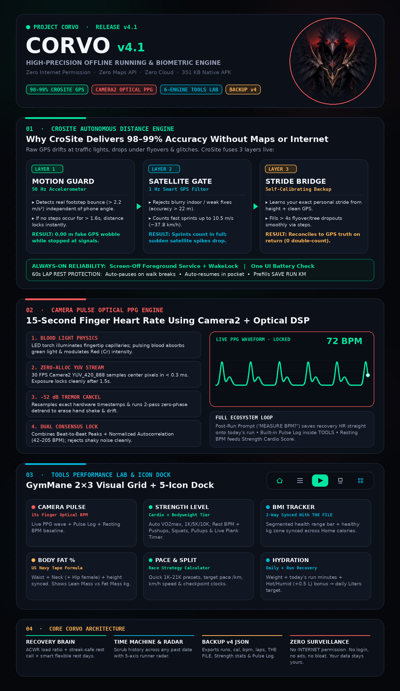

<div align="center">

# CORVO

**A 392 KB, 100% offline running & physiology companion for Android.**
Zero accounts. Zero ads. Zero internet permission. Built in pure Java & XML.



</div>

---

## Why Corvo?

Most modern running apps are **150–300 MB**, force you to create an account, lock basic analytics behind monthly subscriptions, and quietly upload your GPS routes and heart data to cloud servers.

**Corvo is the opposite:**
- **~392 KB total APK size** — faster to download than a single photo, zero lag even on entry-level Android phones.
- **No `INTERNET` permission** — physically incapable of sending a single byte off your device. Everything stays on your phone.
- **Real sensor engineering, zero fluff** — built-in Camera + Flash Heart Rate measurement, motion-guarded GPS + Stride tracking, recovery analysis, and 6 offline health tools in one dark AMOLED app.

---

## Core Engines & Features

### 1. Camera Pulse — Real-Time Optical Heart Rate (BPM)
*Found inside `TOOLS → CAMERA PULSE` (and offered automatically right after saving a timed run).*

You don't need a smartwatch to check your resting or post-run heart rate. **Camera Pulse** uses your phone's rear camera + LED flash to measure your pulse optically (Photoplethysmography / PPG):

- **How it works in plain terms:** Every heartbeat pushes fresh blood through the tiny vessels in your fingertip, making your skin absorb slightly more light for a split second. When you gently cover the camera lens and flash, Camera Pulse reads those subtle color shifts **30 times a second** and draws your live pulse wave in real time.
- **No auto-exposure glitches:** Android cameras normally keep brightening and dimming automatically, which ruins pulse readings. Corvo waits 1.5 seconds for your finger to settle, then **locks exposure & white balance** so the only signal left is your actual heartbeat.
- **Built for real hands (not lab tripods):** A 2-pass zero-phase drift filter removes tiny hand shakes and breathing sway before matching individual beat intervals and signal periodicity across 42–205 BPM. If your finger slips or the signal is noisy, Corvo rejects bad frames instead of guessing a fake number.
- **Pulse Log & Ecosystem Sync:** Tag measurements as **`RESTING`**, **`POST-RUN`**, or **`CHECK`**. Post-run BPM saves straight onto your run record, and your Resting BPM automatically feeds into your **Strength Level** score.

---

### 2. CroSite — 3-Layer Offline GPS + Stride Bridge
*Found inside the center `▶` Play / Timer tab (`CROSITE GPS` vs `TIMER ONLY`).*

Raw phone GPS drifts constantly when you stand still and drops out under trees or bridges. **CroSite** combines three lightweight layers so your outdoor distance stays clean:

1. **Motion Guard (No Fake Drift):** Uses your phone's accelerometer to confirm real running movement before accepting small GPS hops — standing at a crossing won't pile up ghost meters.
2. **Screen-Off Foreground Tracking:** Runs cleanly as a low-power foreground service with a wake lock so your distance keeps counting inside your pocket with the screen off.
3. **Self-Calibrating Stride Bridge:** As you run with good GPS, CroSite learns your natural stride automatically. If satellites briefly drop under heavy cover, it bridges the gap from your real stride instead of freezing.
4. **Smart Lap Rest Support:** Switch to **`RUN`** mode and press **`LAP`** anytime to mark a segment and trigger an automatic **60-second rest countdown**. CroSite pauses automatically during your rest and resumes the instant you finish or tap **`SKIP REST`**. When you hit **`SAVE RUN`**, your measured distance pre-fills cleanly.

---

### 3. Recovery Brain & Flexible Streak System
Corvo tracks consistency without punishing real recovery:

- **Cold-Start Aware (`STILL LEARNING`):** New runners aren't falsely flagged for overload on Day 1 — Corvo watches your first runs to establish a personal baseline first.
- **4-Signal Analysis:** Compares your current week against your true baseline across **Load** (including sudden 1-day distance spikes), **Intensity** (back-to-back fast days), **Fatigue** (consecutive run days), and **Mood** delta (`PRIMED · STEADY · CAUTION · REST CALL`).
- **Flexible Rest Days (`Settings → REST DAY`):** Pick up to **2 weekly default rest days** or move rest days inside the current week without breaking your streak. If Recovery Brain spots overload, tap **`REST TODAY`** right inside the breakdown panel to shift a rest day immediately.
- **6 Crow Evolution Ranks:** Streak milestones (**7 · 15 · 30 · 50 · 100 · 365 days**) unlock progressive Crow forms from **Couch** up to **Legend**.

---

### 4. TOOLS Tab — 6 Offline Physiology Labs
All synced two-way with your personal **THE FILE** profile (zero duplicated entry):

1. **Camera Pulse:** Live PPG optical BPM scanner + tagged **Pulse Log**.
2. **Strength Level:** Combines auto Cardio + Resting BPM with bodyweight reps (**Pushups, Squats, Pullups** & a built-in live **Plank** stopwatch).
3. **BMI:** Instant Body Mass Index with healthy range markers.
4. **Body Fat %:** Offline US Navy waist/neck/hip estimator.
5. **Pace & Split Calculator:** Convert target distance & time into pace, speed, and split targets.
6. **Hydration Target:** Daily baseline + sweat-adjusted water goal from your weight & activity.

---

### 5. `THE FILE`, Time Machine, Share Cards & 100% Local Backup
- **`THE FILE` (Tap the Crow on Home):** Your local runner dossier showing Name, Codename, Body/BMI, Age, City, All-Time Record, **Mood Profile**, and **Strongest Day**. Tap any row to update all fields in one place.
- **Mood Insight:** Log your before/after run emojis to discover how your starting mood shifts your actual `/km` pace in plain English.
- **Time Machine (`BEST` tab slider):** Scrub backward through past dates to view historical streaks, stats, and trends as they stood on any day.
- **Offline PNG Share Cards (`LOG → SHARE`):** Export crisp dark AMOLED posters (**Radar Profile**, **Stat Card**, **Day Card** with lap curves, and **Runner Dossier**).
- **Single-File JSON Backup (`LOG → EXPORT / IMPORT`):** Save everything — runs, laps, BPM, body measurements, and Pulse Log — into one portable `corvo-backup.json` file. Merging never wipes existing entries.
- **1×1 Streak Widget:** Add Corvo's lightweight home-screen streak widget from your phone's launcher.

---

## Quick Controls & Hidden Triggers

New to Corvo? You can also read this full guide inside the app anytime via **Settings (Gear Icon) → `HOW TO USE`**:

- **Tap `CORVO` Header:** View Corvo's Identity Card.
- **Tap the Crow Card on Home:** Open **`THE FILE`** (dossier + editor).
- **Tap the Recovery Strip:** View the 4-bar Load/Intensity/Fatigue/Mood breakdown.
- **Long-Press the Score Number:** Inspect the exact Run Score formula breakdown.
- **Swipe Right on a Run in `LOG`:** Pin / Unpin a **⭐** milestone run to Home.
- **Tap a Slider's Big Number in `TOOLS`:** Type an exact value manually.

---

## Download & Install

1. Open the **[Releases](https://github.com/Ayushxxy/Corvo/releases)** page on this repository.
2. Download the latest **`Corvo-v*.apk`** file.
3. Tap to install on Android 7.0+ (`minSdk 24`, `targetSdk 33`).
4. On first launch, enter your name and optional height/weight/DOB/city so calories, BMI, and CroSite Stride Bridge calibrate to you from Day 1.

### Permissions Explained
Corvo requests **no network permissions at all** (`INTERNET` is completely absent from `AndroidManifest.xml`):
- `ACCESS_FINE_LOCATION` / `FOREGROUND_SERVICE` / `WAKE_LOCK`: Optional — used only when you run with **CroSite GPS** enabled.
- `CAMERA`: Optional — used only when you open **Camera Pulse** to read optical fingertip BPM (no photos or videos are saved).
- `POST_NOTIFICATIONS`: Optional — shows the silent live distance notification during active CroSite tracking.

---

## Build From Source (No Gradle Required)

Corvo compiles cleanly from pure Android SDK 33 + JDK 17 in ~5 seconds using standard CLI tools (`aapt2`, `javac`, `d8`, `zipalign`, `apksigner`):

```bash
# 1. Install Android SDK 33 build-tools + JDK 17 into /var/tmp/carvo-sdk
bash setup.sh

# 2. Compile, dex, align, and sign locally
bash build.sh
```

The build outputs `app/build/Corvo-debug.apk` signed with a locally generated debug keystore (never committed to git).

---

## License

Released under the [MIT License](LICENSE).
